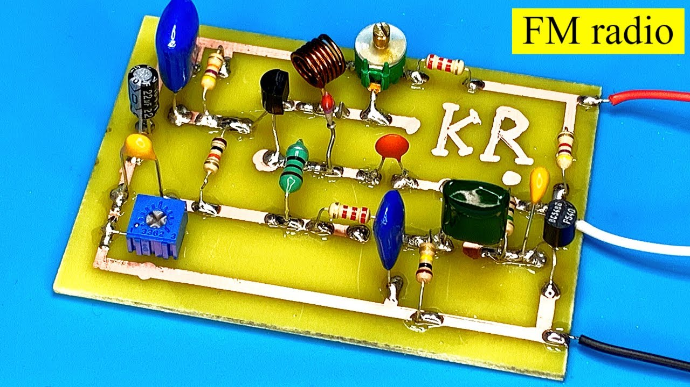
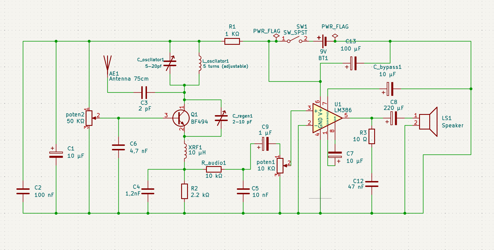
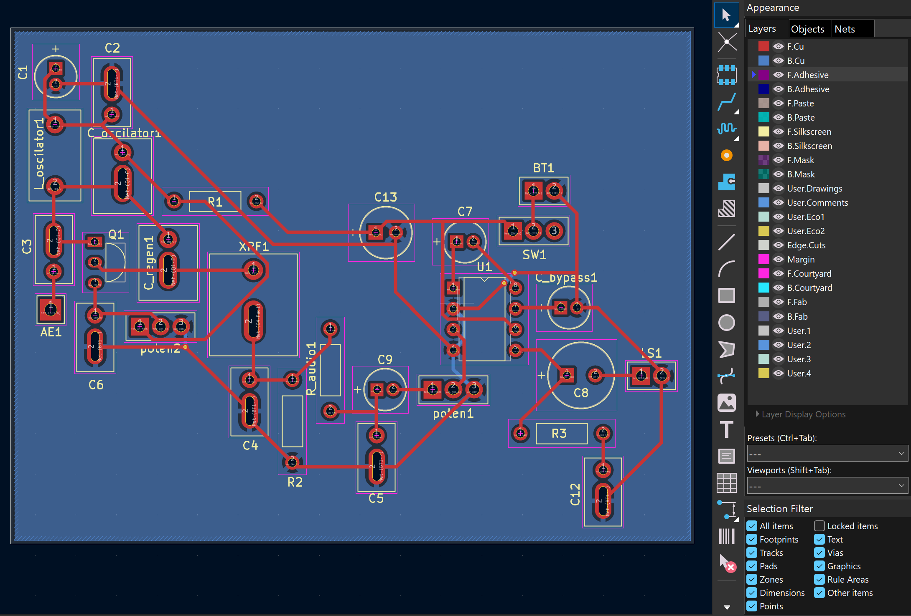
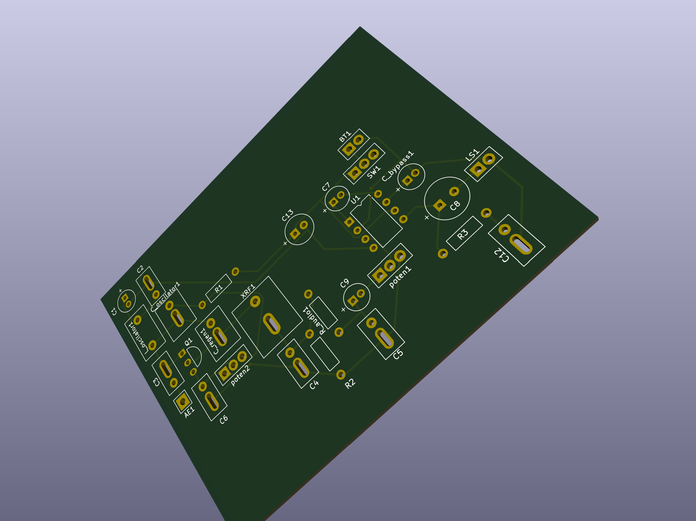

# FM-radio
This project is essentially a small FM radio receiver that I could build with some cheap components and some things I already had at home. I wanted to do this project because I've always loved electronics, and the way radios made it possible to hear someone that is miles away always felt like magic to me. I am building this with no microcontroller or chip that does almost everything for me because I wanted to really learn how everything works. It turns out this project was a bit more complicated than I expected, and I had to spend a lot of time learning about RLC circuits and wave filtering. Although it's not perfect, I think I designed it well enough that we can at least hear a distorted voice when it is working. It's not a perfect radio and the quality will probably be very poor, but I think I completed my goal and it's a good start.
 
### Example of inspiration:

Image from youtube video (https://www.youtube.com/watch?v=K_KGpeN28-U)
 
## How it works
 
While making this I saw a lot of different designs for similar radios. Mine is made of essentially two parts:
### The receiver
- The coil (L) and the small variable capacitor (C_osc) choose which frequency the radio "listens" to. The frequency the radio points to is around 100 MHz, and changing the capacitor or slightly adjusting the coil (it's handmade) moves it across the FM band;
- The antenna is a 75 cm wire because that's one fourth of the wavelength of a normal radio wave. It connects through a tiny 2 pF capacitor (C3) so it does not mess up the tuning;
- The transistor (Q1) makes the circuit almost oscillate, which makes it very sensitive. This type of receiver is called *super-regenerative* because it uses its positive feedback to amplify the signal;
- The second variable capacitor (C_regen) and a potentiometer (poten2) control how strongly the transistor affects the circuit;
- A small choke (inductor XRF1) and some capacitors let only the audio move on to the next stage;
- R1, C1 and C2 clean the power for the receiver;
### The amplifier (LM386)
- The sound goes through a filter (R_audio and C5) that removes the noise, then through the volume pot (poten1);
- The LM386 amplifies the audio (about 200 times) and sends it to the speaker;
- The other capacitors around the chip (C7, C8, C13, C_bypass1, C12) keep it stable and smooth the power;
## Pictures
 
Schematic:
 

 
PCB layout:
 

 
3D model:
 

 
## Wiring
 
Some parts are connected with wires because I'm still not sure about their dimensions:
 
| Part | Pad | Goes to |
|---|---|---|
| Battery | 1 | + |
| Battery | 2 | − |
| Switch | 1 | circuit (switched +9 V) |
| Switch | 2 | battery + |
| Switch | 3 | not used |
| Volume pot (10 kΩ) | 1 | audio in |
| Volume pot (10 kΩ) | 2 (middle) | LM386 pin 3 |
| Volume pot (10 kΩ) | 3 | ground |
| Regeneration pot (50 kΩ) | 1 | filtered +9 V |
| Regeneration pot (50 kΩ) | 2 (middle) | base of the transistor |
| Regeneration pot (50 kΩ) | 3 | ground |
| Speaker | 1 | amplifier output |
| Speaker | 2 | ground |
| Antenna | 1 | 75 cm wire |
 
The electrolytic capacitors have a polarity so pay attention. All the other components are soldered on the pcb as in the sketch.
 
## Bill of materials
The list below shows all the materials needed. The ones that bring more than one component are there because it was cheaper than buying one in another website (there are not many electronics stores where I live, so sorry for that).
 
| Qty | Part | Value | Where on the board | Link |
|---|---|---|---|---|
| 1 | Transistor | BF494 | Q1 | [link](https://pt.aliexpress.com/item/1005008378765100.html) |
| 1 | Amplifier chip | LM386 | U1 | [link](https://www.ptrobotics.com/audio/10381-lm386n-3-amplificador-audio-de-baixa-tensao-700mw.html) |
| 1 | Resistor | 1 kΩ | R1 | [link](https://www.ptrobotics.com/resistencias-5-250mw/45-resistencia-1k-5-250mw.html) |
| 1 | Resistor | 2.2 kΩ | R2 | [link](https://www.ptrobotics.com/resistencias-1-600mw/9094-resistencia-2k2-1-600mw.html) |
| 1 | Resistor | 10 kΩ | R_audio1 | [link](https://www.ptrobotics.com/resistencias-5-250mw/62-resistencia-10k-5-250mw.html) |
| 1 | Resistor | 10 Ω | R3 | [link](https://www.ptrobotics.com/resistencias-5-250mw/22-resistencia-10r-5-250mw.html) |
| 1 | Ceramic capacitor | 2 pF | C3 | [link](https://pt.aliexpress.com/item/1005003654568680.html) |
| 1 | Ceramic capacitor | 1.2 nF | C4 | [link](https://www.ptrobotics.com/condensador-ceramicos/12739-condensador-ceramico-12nf-50v.html) |
| 1 | Ceramic capacitor | 4.7 nF | C6 | [link](https://www.ptrobotics.com/condensador-ceramicos/2179-condensador-ceramico-47nf-50v.html) |
| 1 | Ceramic capacitor | 10 nF | C5 | [link](https://www.ptrobotics.com/condensador-ceramicos/509-condensador-ceramico-10nf-50v.html) |
| 1 | Ceramic capacitor | 47 nF | C12 | [link](https://www.ptrobotics.com/condensador-ceramicos/3508-condensador-ceramico-47nf-50v.html) |
| 1 | Ceramic capacitor | 100 nF | C2 | [link](https://pt.aliexpress.com/item/1005011819339428.html) |
| 1 | Trimmer capacitor | 2–10 pF | C_regen1 | [link](https://www.ptrobotics.com/trimmers/6906-2-10pf-variable-trimmer-capacitor.html) |
| 1 | Trimmer capacitor | 5–20 pF | C_oscilator1 | [link](https://pt.aliexpress.com/item/1005001616140065.html) |
| 3 | Electrolytic capacitor | 10 µF | C1, C7, C_bypass1 | [link](https://www.ptrobotics.com/condensador-electroliticos/518-condensador-electrolitico-10uf-25v.html) |
| 1 | Electrolytic capacitor | 1 µF | C9 | [link](https://www.ptrobotics.com/condensador-electroliticos/3398-condensador-electrolitico-1uf-16v.html) |
| 1 | Electrolytic capacitor | 100 µF | C13 | [link](https://www.ptrobotics.com/condensador-electroliticos/529-condensador-electrolitico-100uf-25v.html) |
| 1 | Electrolytic capacitor | 220 µF | C8 | [link](https://www.ptrobotics.com/condensador-electroliticos/533-condensador-electrolitico-220uf-25v.html) |
| 1 | RF choke | 10 µH | XRF1 | [link](https://www.ptrobotics.com/indutores/993-indutor-radial-10uh-15a-007r.html) |
| 1 | Potentiometer | 50 kΩ | poten2 | [link](https://www.ptrobotics.com/potenciometros-rotativos/7981-potenciometro-linear-50k-125mw-montagem-com-fio.html) |
| 1 | Potentiometer | 10 kΩ | poten1 | [link](https://www.ptrobotics.com/potenciometros-rotativos/5267-potentiometer-linear-10k-125mw.html) |
| 1 | Switch | SPDT(one pin not used) | SW1 | [link](https://www.ptrobotics.com/interruptores-slide/1770-spdt-slide-switch.html) |
| 1 | 9 V battery clip | 9 V | BT1 | [link](https://pt.aliexpress.com/item/1005010458753879.html) |
| 1 | Speaker | small | LS1 | No link (I have it at home) |
| 1 | 9 V battery | 9 V | BT1 | No link (I have it at home) |
| 1 | Wire | 75 cm | antenna | No link (I have it at home) |
| 1 | Enamelled copper wire | about 1 mm | coil (5 turns, wound by hand) | No link (I have it at home) |
 
## Files
 
- `Radio_1_v2.kicad_pcb`: the PCB
- `Radio_1.kicad_sch`: the schematic
- `radio.pretty/`: footprints I made for the parts
- `images/`: pictures
